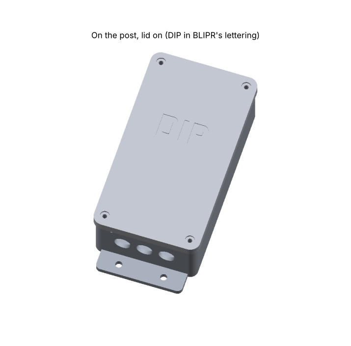
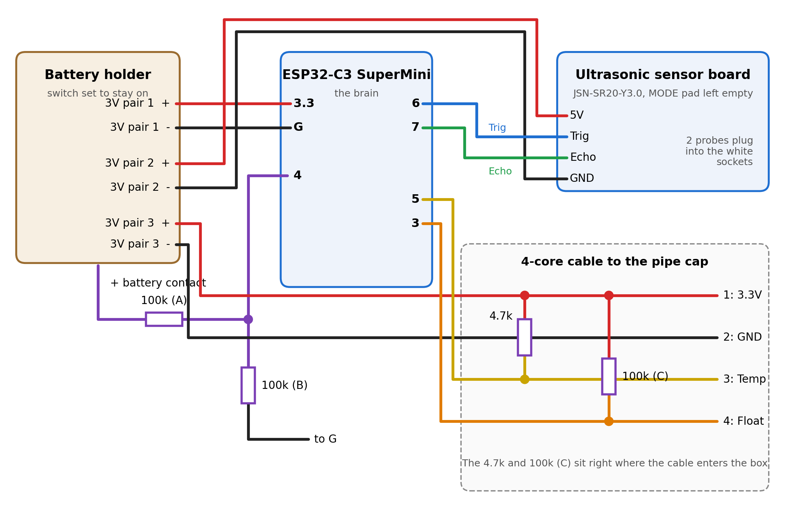
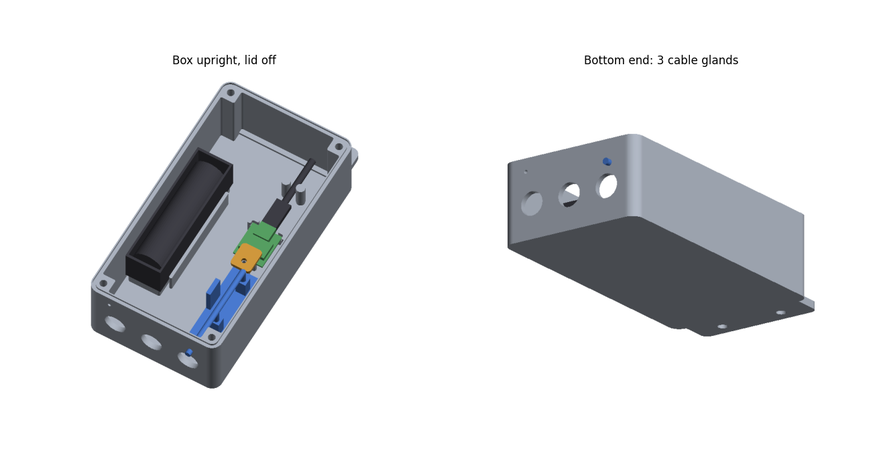

# DIP (Depth In Pond)

A battery-powered, Wi-Fi water-level sensor for a backyard pond, built for Home Assistant. It watches the water
level and temperature, and shuts the pond pumps off before they can run dry.

- **Level:** a dual-probe JSN-SR20 ultrasonic sensor looks down a 3" PVC "stilling pipe" standing in the pond.
  The pipe keeps waterfalls, ripples and pond netting from confusing it. Reports every 20 minutes.
- **Float switch backup:** a float switch inside the same pipe wakes the board the moment the water drops below it,
  so a leak or a stuck fill valve is caught in seconds, not 20 minutes.
- **Water temperature:** a DS18B20 probe hangs in the pipe.
- **What Home Assistant does with it** (`ha/dip_package.yaml`): shows the level in inches below full, turns off the
  first pump when the water drops 3", turns off all the pumps and sends a critical phone alert when the water drops
  below the float, turns them back on when the water comes back, and warns you if DIP goes quiet or its battery
  gets low. The pumps can be on any smart plug Home Assistant can switch.
- **Power:** one 18650 cell in a plain holder, charged through the Seeed XIAO ESP32-C6's USB-C. The XIAO
  sleeps between readings (about 20 seconds awake every 20 minutes), so a cell lasts months.

**The full build, step by step, with pictures:** [docs/DIP-assembly-guide.pdf](docs/DIP-assembly-guide.pdf) (Word version: [docx](docs/DIP-assembly-guide.docx)).
No electronics experience needed; you test as you go.

**Print files on MakerWorld:** [DIP pond sensor](https://makerworld.com/en/models/3526344-dip-pond-sensor#profileId-4031430) (3MF with every plate and print profile).

## Parts

| Part | Notes |
|---|---|
| Seeed XIAO ESP32-C6 | The brain, and it charges the cell. Wires solder straight into its pin holes (no header pins). |
| Plain single-18650 holder with wire leads (76 x 21 x 20 mm, one hole in its floor), plus a name-brand 18650 cell | Screws to a platform in the box. Don't use a "battery shield" board with a 5V booster: it drains the cell in a day or two. |
| Short USB-C cable | Stays plugged into the XIAO so you can charge with the lid off. |
| JSN-SR20 dual-probe ultrasonic sensor (sold as JSN-SR20-Y1: 48 x 23 mm board, two 21.5 mm probes on cables) | Leave the MODE pad empty (normal Trig/Echo mode). It runs on 3.3V here, even though the board says 5V. |
| Vertical float switch (M10 stem) | Must be OPEN when the water is normal. |
| DS18B20 waterproof temperature probe (1 m) | Its included 4.7k resistor is the pull-up. |
| 4-core outdoor cable, box to pipe cap | 3.3V, GND, temperature data and float, all through one gland. |
| Resistors | 3 x 100k (battery reading divider + float pull-up), 1 x 4.7k (temperature probe pull-up). |
| 3 x PG7 cable glands | One for each probe cable, one for the 4-core cable. |
| 3" PVC pipe (89 mm OD, 76 mm ID), about 30" long | 3-4 x 1/4" holes in the bottom 2-3", one 1/8" vent near the top. |
| Cinder block + pea gravel | Holds the pipe upright in the pond. |
| Screws | 8 x M3 heat-set inserts; 4 x M3 screws with rubber washers (box lid) and 3 more (pipe cap top); 5 x M2.5 x 6 (sensor board and XIAO clamp); 1 x M3 x 8 (battery holder); 2 x M4 stainless (float bracket); 1 short stainless screw (locks the cap to the pipe); 2 wood screws to hang the box on a post. |

## Wiring

| XIAO pin | Goes to |
|---|---|
| BAT + / BAT - (pads underneath) | the holder's red / black wires |
| D0 | middle of the 100k/100k battery divider: 100k (A) to BAT +, 100k (B) to BAT - |
| 3V3 / GND | the sensor's 5V / GND pins, and 4-core wires 1 / 2 |
| D4 / D5 | sensor Trig / Echo |
| D3 | 4-core wire 3, temperature data (4.7k from wire 1) |
| D1 | 4-core wire 4, float (100k (C) from wire 1). Wakes the board. The float must be OPEN when the water is normal |

The two pull-ups sit at the cable's box end. At the pipe cap:
wire 1 to the probe's red, wire 2 to the probe's black and one float wire, wire 3 to yellow, wire 4 to the other float wire.

## Firmware (`firmware/`)

`firmware/dip.yaml` is ESPHome.
- Wakes every 20 minutes, or every 2 minutes while the float is low, and right away when the float drops or comes back up.
- Each time it sends the level (the middle of 5 readings), water temperature, battery voltage and %, float state and Wi-Fi signal, then sleeps.
- Turn on **DIP stay awake** in Home Assistant to keep it awake for wireless updates. It sees the switch on its next wake, so allow up to 20 minutes. Turn it off when you're done: awake, it drains the battery in a day or two.

Setup:
1. Copy `secrets.example.yaml` to `secrets.yaml` and fill it in (it stays out of git).
2. First flash over USB: `esphome run firmware/dip.yaml`. If the board isn't found, hold B (boot) and tap R (reset).
3. Battery reading: check the cell with a meter and compare it with DIP's "Battery voltage". If they differ, scale
   the `multiply:` value under the battery voltage sensor by (meter ÷ DIP) and flash again.

Built with ESPHome 2026.10 (the XIAO C6 needs 2025.7 or newer). Projects at https://esphome.io.

## Home Assistant (`ha/`)

`ha/dip_package.yaml` is a Home Assistant package. The steps at the top of the file cover:
- where to put it
- which pump and phone entity IDs to change
- calibrating: with the pond full, type DIP's "Distance to water" into "Pond full distance"

## Printed parts (`case/`)

The STL files are in `case/out/`, ready to print. They're built by `case/pond_case.py`: change the numbers at the
top and run `python3 case/pond_case.py` (needs `pip install manifold3d numpy`). `python3 case/previews.py` redraws
the preview pictures.

PETG or ASA outdoors; PLA goes soft in the sun.

| File | What | How to print |
|---|---|---|
| `box.stl` | Electronics box, hangs upright on a post by the tab at the top (2 screws). A platform for the battery holder (1 screw), 4 standoffs for the sensor board, corner stops and a screw post for the XIAO, clip posts for the USB-C cable, 3 cable glands in the bottom end. Charge through the XIAO's USB-C with the lid off. About 3.1" x 6.4" x 1.7" | as is, back plate down, no supports |
| `box_lid.stl` | Lid with a drip edge, two stiffening ribs, washer seats round the 4 corner screws, "DIP" lettering | as is (already flipped) |
| `esp_clamp.stl` | Small tab that holds the XIAO's far end down, pressing on its metal can | flat |
| `gasket.stl` | TPU seal for the groove in the box rim (or use 1.5 mm foam cord) | 95A TPU, flat, 100 % infill |
| `pipe_cap.stl` | Slides over the pipe and holds both probes; a slot in the rim lets the cables out sideways | upside down (rim on the bed); supports only under the probe band |
| `pipe_cap_top.stl` | Flat lid for the pipe cap, 3 screws | flat |
| `float_bracket.stl` | Holds the float switch inside the pipe, 2 screws through the pipe wall | as is (lying on its side) |
| `float_bracket_outside.stl` | Or this one: holds the float switch OUTSIDE the pipe. Two upright slots give 2" of height adjustment (M4 screws through the pipe wall, washers outside, nuts inside) | as is (lying on its side) |

## Version history

- **v0.4:** Seeed XIAO ESP32-C6 and a plain 18650 holder instead of the ESP32-C3 SuperMini and a battery shield
  board. The shield's always-on 5V booster emptied a full cell in about a day; the XIAO charges the cell itself
  and sleeps at a few microamps. New pins (see Wiring), new battery platform, XIAO mount and cable clip.
- **v0.3:** cable glands 22 mm apart, so the lock nuts can turn. The two bottom lid posts are shorter, with 45°
  undersides. The sensor board moved away from the battery holder. The bottom mounting tab was removed, because
  the glands blocked its screws.
- **v0.2:** first build.

## License

MIT: see [LICENSE](LICENSE). That covers the firmware, the Home Assistant package, the case models and the guide.
