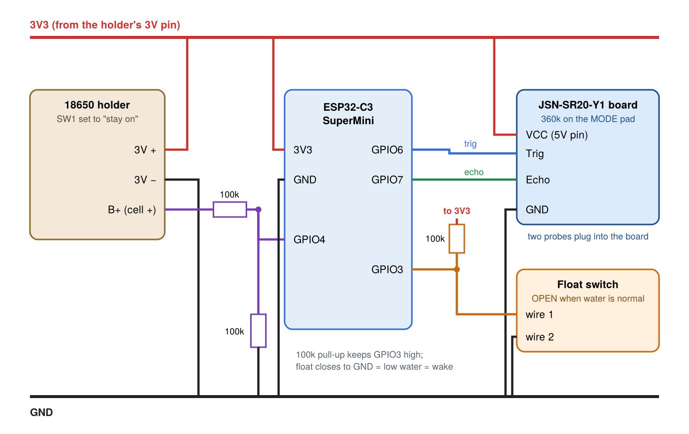

# DIP (Depth In Pond)

A battery-powered water-level sensor for the pond, reporting to Home Assistant over Wi-Fi.

- **Level:** a JSN-SR20-Y1 ultrasonic sensor looks down a 3" PVC "stilling pipe" standing in the pond, so the
  waterfall, fountain and net can't confuse it. Reports every 20 minutes.
- **Tripwire:** a float switch inside the same pipe wakes the board the moment the water drops too low, so a
  plumbing failure is caught in seconds, not 20 minutes.
- **What Home Assistant does with it:** graphs the level, alerts on low water, and turns the pond pumps off
  (Tuya plug) so they don't run dry, then back on when the level recovers.
- **Power:** one 18650 cell in the same battery holder as BLIPR, ESP32-C3 SuperMini in deep sleep between
  readings. Target: 5-8 months per charge.

## Parts

| Part | Notes |
|---|---|
| ESP32-C3 SuperMini | on hand |
| 18650 battery holder (USB-C + micro-USB, same as BLIPR) + 18650 cell | on hand. Set its slide switch SW1 to **stay on** (not auto-shutdown) |
| JSN-SR20-Y1 ultrasonic sensor (dual probes, 48 x 23 mm board) | ordered |
| Mini vertical float switch (PP, M10 stem) | 16" leads: spliced onto the 4-core cable inside the pipe cap's chamber |
| DS18B20 waterproof temperature probe (1 m) | ordered. Hangs inside the pipe near the bottom; spliced onto the 4-core cable in the cap |
| 4-core outdoor cable, box to pipe cap | carries 3V3, GND, float, probe data through one gland. Splices: solder + adhesive-lined heat shrink |
| Resistors | 360 kOhm (sensor low-power mode, soldered on the sensor board's MODE pad), 3 x 100 kOhm (battery reading divider + float pull-up), 4.7 kOhm (temperature probe pull-up) |
| 3" PVC pipe (89 mm OD, 76 mm ID), about 30" long | on hand. 3-4 x 1/4" holes in the bottom 2-3", one 1/8" vent near the top |
| Cinder block + pea gravel | holds the pipe upright in the pond (level it while packing the gravel). Cables run along the back of the coping to the box on the post, under the net |
| 3 x PG7 cable glands | on hand |
| 5 x M2.5 x 6 screws (4 sensor board, 1 SuperMini clamp) | |
| 4 x M3 heat-set inserts + 4 x M3 screws with rubber washers (lid), 3 more inserts + M3 screws (pipe cap top), 2 x M4 screws (float bracket), 1 short stainless screw (locks the cap to the pipe; pilot-drill the PVC) | |

## Wiring

| SuperMini pin | Goes to |
|---|---|
| 3V3 | holder 3V +, sensor VCC, 100k pull-up for the float |
| GND | holder 3V -, sensor GND, float wire 2, bottom of the battery divider |
| GPIO3 | float switch wire 1 (+ 100k to 3V3). Wakes the board instantly. Float must be OPEN when the water is normal |
| GPIO4 | middle of the 100k/100k divider from the cell's + (battery reading) |
| GPIO6 | sensor Trig |
| GPIO7 | sensor Echo |
| GPIO5 | temperature probe data (yellow) + 4.7k to 3V3; probe red to 3V3, black to GND |

## Firmware (`firmware/`) and Home Assistant (`ha/`)

- `firmware/dip.yaml`: ESPHome. Wakes every 20 min (every 2 min while the float is low), takes 5 readings,
  sends the middle one plus the water temperature, sleeps. Copy `secrets.example.yaml` to `secrets.yaml` and fill it in.
  First flash over USB: `esphome run firmware/dip.yaml` (hold BOOT, tap RESET if the board isn't found).
  Test-compiled with ESPHome 2026.10.0.
- `ha/dip_package.yaml`: Home Assistant package. Pond level in inches below full, "Pond water low", a critical
  phone alert + pumps off when low, pumps back on 10 min after it recovers, alerts if the sensor goes quiet or its
  battery drops below 20 %, and the "DIP stay awake" switch for wireless updates. Check the entity IDs at
  the top of the file first.
- Calibrate once: with the pond full, copy "Distance to water" into "Pond full distance" in HA.

## Printed parts (`case/`)

`python3 case/pond_case.py` builds every part into `case/out/` (needs `pip install manifold3d numpy`).
`python3 case/previews.py` draws the preview pictures.

| File | What | Print |
|---|---|---|
| `box.stl` | electronics box, stands upright on the pergola post (about 3" x 5.75" x 1.75"): BLIPR's battery-holder mount, 4 screw standoffs for the sensor board, hooks + a screw post for the SuperMini, 3 glands in the bottom end. No charge-port or button holes: charge through the holder's USB-C with the lid off, or take the cell out | as is, back plate down. PETG or ASA |
| `box_lid.stl` | lid with a drip edge, two stiffening ribs underneath, washer seats round the 4 corner screws, and "DIP" cut 0.6 mm into the front in BLIPR's lettering (18 mm tall) | as is (already flipped) |
| `esp_clamp.stl` | small tab that holds the SuperMini's far end down (its USB end slides under two lips first); one M2.5 x 6 screw | flat |
| `gasket.stl` | TPU ring for the rim groove: 1.6 wide x 1.9 tall, stands 0.5 mm proud so the lid squeezes it about 25 % | 95A TPU, flat, 100 % infill |
| `pipe_cap.stl` | slides over the pipe (90 mm bore), holds both probes on a band across the middle; the rest of the plate is open for the float and temperature cables. Slot in the rim where the 3 cables leave sideways (point it at the post), lock-screw hole in the skirt. 45-degree chamfer under the ledge | upside down (rim on the bed); supports only under the probe band |
| `pipe_cap_top.stl` | flat lid: 3 screws into the cap's posts, closes the top of the cable slot. Keeps rain and bugs out (doesn't need to seal: everything in the cap is waterproof) | flat |
| `float_bracket.stl` | holds the float switch inside the pipe (no brace) | as is: already lying on its side |

Cable holes: screw a PG7 cable gland into each (nut inside); tightening its cap seals round the cable, no silicone needed.
Gasket: print `gasket.stl` in TPU, or lay 1.5 mm foam cord in the rim groove.

### Draft v0.1: check before printing
- **Probe hole** is a guess (18.6 mm, `PROBE_D`): measure the probes when they arrive.
- **Sensor board** screws onto 4 standoffs (M2.5 x 6 into 2.2 mm pilots), holes assumed 3 mm in from each corner
  (`SB_HOLE_INSET`): measure yours.
- **SuperMini** has no holes: USB end under two corner lips, far end under `esp_clamp.stl` with one screw. It rests
  on its two short ends only, so solder the wires straight into its pin holes (no header pins underneath).
- The holder's USB-C port faces into the box with room beside it for a plug, so it charges with the lid off.
